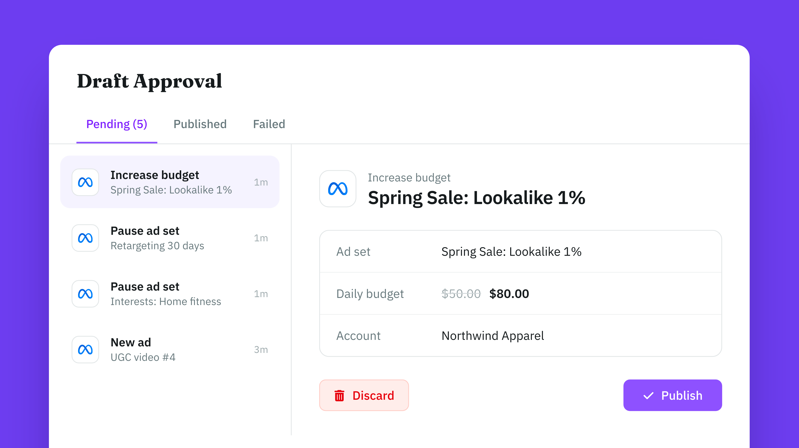

# Meta Ads MCP Server

[](https://registry.modelcontextprotocol.io/v0/servers?search=io.github.adkit/meta-ads) [](https://adkit.so/features/ads-mcp/meta) [](./LICENSE)

Connect Meta Ads (Facebook and Instagram) to Claude, ChatGPT, Cursor, Codex or any AI app that supports MCP. AdKit hosts the server, so you only add an address to your AI app.

- **MCP address:** `https://mcp.adkit.so/meta-ads`
- **Website:** [AdKit](https://adkit.so/features/ads-mcp/meta)

Every change is saved as a draft first, so your AI can't spend money on its own. Nothing goes live on Meta Ads until you approve it.



## What you can do

- Create and edit campaigns, ad sets, ads and creatives on Facebook and Instagram
- Upload images and videos to your ad account
- Read spend, results, ROAS, CTR and video metrics, with breakdowns
- Search interests for targeting, and read your lead forms and conversion events

## Example prompts

- "Which Meta ad sets spent the most last week with the fewest purchases?"
- "Create a traffic campaign for our spring sale, $50 a day, US only. Save it as a draft."
- "Pause every ad with a frequency above 4 in the last 7 days."
- "Find interests related to home workouts and add them to the ‘Fitness’ ad set."

## Set up

You need an AdKit account. On first use, you sign in to AdKit and connect your Meta Ads account.

There are two ways to connect:

- **All platforms:** the main AdKit connector. One connection for Google, Meta, TikTok, LinkedIn, Microsoft, Reddit, X and Pinterest. Pick this if you run ads on more than Meta Ads.
- **Meta Ads only:** the address above. Your AI only sees the Meta Ads tools.

### Claude (web and desktop)

- **All platforms:** [install AdKit from the Claude directory](https://claude.ai/directory/adkit), in one click.
- **Meta Ads only:** Settings → **Connectors** → **Add custom connector** → paste `https://mcp.adkit.so/meta-ads`.

### ChatGPT

- **All platforms:** [add the AdKit app](https://chatgpt.com/apps/adkit/asdk_app_6a1e848decdc8191a4974b315c51661f), in one click.
- **Meta Ads only:** Settings → **Connectors** → **Add custom connector** → paste `https://mcp.adkit.so/meta-ads`.

### Claude Code

As a plugin:

```
/plugin marketplace add adkit/meta-ads-mcp
/plugin install meta-ads@adkit-meta-ads
```

Or as an MCP server only:

```
claude mcp add --transport http adkit-meta-ads https://mcp.adkit.so/meta-ads
```

### Gemini CLI

```
gemini extensions install https://github.com/adkit/meta-ads-mcp
```

### Cursor

Add to `~/.cursor/mcp.json`:

```json
{
  "mcpServers": {
    "adkit-meta-ads": {
      "url": "https://mcp.adkit.so/meta-ads"
    }
  }
}
```

### Codex

Add to `~/.codex/config.toml`:

```toml
[mcp_servers.adkit-meta-ads]
url = "https://mcp.adkit.so/meta-ads"
```

In Claude Code, Gemini CLI, Cursor and Codex, use `https://mcp.adkit.so` instead to connect all platforms.

## Tools

| What | Tools |
| --- | --- |
| Ad accounts | `meta_ads_accounts_connect`, `meta_ads_accounts_disconnect`, `meta_ads_accounts_read`, `meta_ads_accounts_update` |
| Campaigns | `meta_ads_campaigns_create`, `meta_ads_campaigns_delete`, `meta_ads_campaigns_read`, `meta_ads_campaigns_update` |
| Ad sets | `meta_ads_adsets_create`, `meta_ads_adsets_delete`, `meta_ads_adsets_read`, `meta_ads_adsets_update` |
| Ads | `meta_ads_ads_create`, `meta_ads_ads_delete`, `meta_ads_ads_read`, `meta_ads_ads_update` |
| Creatives | `meta_ads_creatives_create`, `meta_ads_creatives_delete`, `meta_ads_creatives_update` |
| Interest targeting | `meta_ads_interests_read` |
| Lead forms | `meta_ads_lead_forms_read` |
| Conversions | `meta_ads_conversions_read` |
| Media library | `meta_ads_media_delete`, `meta_ads_media_read` |
| Results and reporting | `meta_ads_results_read` |
| Media upload | `meta_ads_upload` |
| Direct API requests | `meta_ads_platform_api_request_mutate` |

Every AdKit connector also has these tools:

| Tool | What it does |
| --- | --- |
| `adkit_projects` | List your AdKit projects and pick one |
| `adkit_status` | Show the connected ad accounts |
| `adkit_setup` | Get the link to connect an ad account |
| `adkit_drafts_read` | List saved drafts, or read one |
| `adkit_drafts_update` | Edit a draft before it goes live |
| `adkit_drafts_delete` | Delete a draft |
| `adkit_drafts_publish` | Publish drafts after you approve them |
| `adkit_help` | Look up fields, limits and examples |
| `adkit_feedback` | Report a bug or a missing feature |

## FAQ

### What is the Meta Ads MCP server?

A hosted MCP server from AdKit. It lets Claude, ChatGPT, Cursor, Codex and other AI apps work on your Meta Ads account: Facebook and Instagram campaigns, ad sets, ads, creatives and reports.

### Is the Meta Ads MCP server free?

It is included in every AdKit plan. Plans start at $29 a month, with a 7-day free trial. See [pricing](https://adkit.so/pricing).

### Can my AI change my Meta Ads without asking me?

No. Every create, edit or pause is saved as a draft. It goes live only after you approve it, on AdKit's Draft Approval page or by telling your AI to publish it.

### Do I need an API key or a developer token?

No. You sign in to AdKit in your browser and connect your Meta Ads account there.

### Can I manage several Meta Ads accounts?

Yes. Connect several accounts and keep each client in its own AdKit project. How many projects you get depends on your plan.

### Which AI apps does it work with?

Claude, ChatGPT, Claude Code, Gemini CLI, Cursor, Codex and any app that supports remote MCP servers with OAuth sign-in.

## Other ad platforms

- [Google Ads MCP Server](https://github.com/adkit/google-ads-mcp)
- [TikTok Ads MCP Server](https://github.com/adkit/tiktok-ads-mcp)
- [LinkedIn Ads MCP Server](https://github.com/adkit/linkedin-ads-mcp)
- [Microsoft Ads MCP Server](https://github.com/adkit/microsoft-ads-mcp)
- [Reddit Ads MCP Server](https://github.com/adkit/reddit-ads-mcp)
- [X Ads MCP Server](https://github.com/adkit/x-ads-mcp)
- [Pinterest Ads MCP Server](https://github.com/adkit/pinterest-ads-mcp)
- [All platforms in one connector](https://github.com/adkit/ads-mcp)

## Support and policies

- Help: [adkit.so/support](https://adkit.so/support) or contact@adkit.so
- [Privacy](./PRIVACY.md), [Terms](./TERMS.md), [Security](./SECURITY.md), [Support](./SUPPORT.md)

## Docs server

[`docs-server/`](./docs-server/index.mjs) is a small local MCP server that answers questions about AdKit from this README: setup per AI app, hosted tools, ad platforms, example prompts and the FAQ. It needs no login and does not manage ads; for that, connect the hosted server above. Run it with `npm start` or the Dockerfile.

## License

MIT
